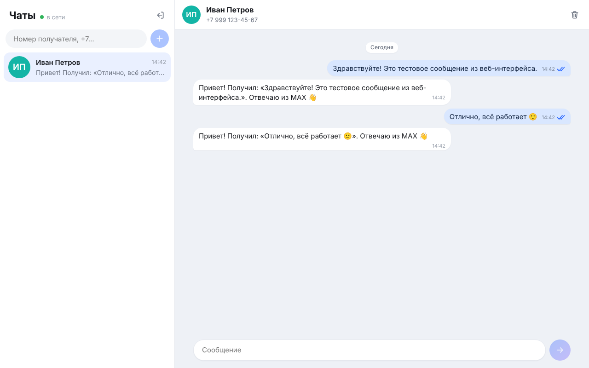

# MAX Chat · GREEN-API

Веб-интерфейс для отправки и получения текстовых сообщений в мессенджере **MAX** через сервис [GREEN-API](https://green-api.com/max). Внешний вид — по мотивам [web.max.ru](https://web.max.ru/).

Тестовое задание на должность «Фронтенд разработчик React».



## Возможности

- Вход по учётным данным инстанса GREEN-API (`idInstance`, `apiTokenInstance`); хост API подставляется автоматически, при необходимости его можно изменить. Данные проверяются методом `getStateInstance`.
- Создание чата по номеру телефона получателя (номер проверяется методом `CheckAccount`, из ответа берётся `chatId`).
- Отправка текстовых сообщений методом [`SendMessage`](https://green-api.com/v3/docs/api/sending/SendMessage/).
- Получение сообщений по технологии [HTTP API](https://green-api.com/v3/docs/api/receiving/technology-http-api/): `ReceiveNotification` (long polling) → обработка → `DeleteNotification`.
- Статусы исходящих: отправляется / отправлено / доставлено / прочитано / ошибка (с повтором отправки).
- Сообщения, отправленные с телефона, тоже появляются в чате; входящие от новых собеседников создают чат автоматически.
- Переписка сохраняется в `localStorage` браузера; светлая и тёмная тема; адаптивная вёрстка для телефона.

## Запуск локально

Требуется Node.js 20.19+ (или 22.12+).

```bash
git clone <ссылка-на-репозиторий>
cd max-chat
npm install
npm run dev
```

Откройте http://localhost:5173.

Другие команды:

```bash
npm test          # юнит-тесты (Vitest)
npm run build     # проверка типов и production-сборка в dist/
npm run preview   # просмотр собранной версии
```

## Как пользоваться

1. Зарегистрируйтесь в [личном кабинете GREEN-API](https://console.green-api.com/), создайте инстанс MAX и авторизуйте его по QR-коду (MAX → Профиль → Устройства → Войти по QR-коду).
2. Скопируйте из кабинета `idInstance`, `apiTokenInstance` и, если отличается, `apiUrl`.
3. Введите их на экране входа.
4. Введите номер получателя (`+7 999 123-45-67`) и нажмите «+».
5. Напишите сообщение и нажмите Enter (Shift+Enter — перенос строки).
6. Ответ получателя появится в чате автоматически.

> Для получения сообщений в настройках инстанса должен быть **пустой `webhookUrl`** и включены уведомления о входящих сообщениях. Если это не так, приложение покажет предупреждение с кнопкой «Включить» (вызовет `SetSettings`). Изменения применяются в течение нескольких минут.

## Устройство проекта

```
src/
  api/greenApi.ts              клиент GREEN-API: запросы, разбор ошибок
  hooks/useNotificationPolling.ts  цикл Receive/DeleteNotification с повтором при ошибках
  lib/notifications.ts         разбор уведомлений в события приложения
  lib/phone.ts                 нормализация и форматирование номера
  lib/storage.ts               сохранение учётных данных и чатов в localStorage
  state/chats.ts               reducer чатов: сообщения, статусы, непрочитанные
  components/                  LoginScreen, Sidebar, ChatWindow, Avatar, иконки
```

Технические решения:

- **Без бэкенда.** GREEN-API разрешает CORS, поэтому браузер обращается к API напрямую. Ключ хранится только в `localStorage` этого браузера.
- **chatId vs номер.** В MAX рекомендуется отправлять по `chatId`, полученному через `CheckAccount`. Если проверка номера недоступна (лимиты), отправка идёт по `79991234567@c.us`, а настоящий `chatId` подставляется из первого уведомления по этому собеседнику (сопоставление по `senderPhoneNumber`).
- **Надёжная очередь.** Уведомление удаляется из очереди после обработки; если удаление не прошло, повторная доставка отсекается по `idMessage`. При сетевых ошибках — экспоненциальная пауза до 30 с.
- **Без лишних зависимостей:** React + TypeScript + Vite, состояние — `useReducer`.

## Деплой

Сборка статическая (`npm run build` → `dist/`) и работает с любого пути. В репозитории есть workflow `.github/workflows/deploy.yml` для GitHub Pages: включите Pages (Settings → Pages → Source: GitHub Actions), и при пуше в `main` сайт опубликуется автоматически.
